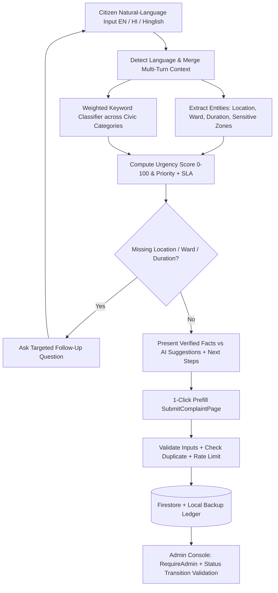

# NAGRIK AI — Context-Aware Civic Grievance & Public Assistance Platform

[](https://reactjs.org/)
[](https://vitejs.dev/)
[](https://tailwindcss.com/)
[](https://firebase.google.com/)
[](https://vitest.dev/)

> **Hackathon**: Hack2Skill – PromptWars AI Challenge 2026  
> **Live Demo**: [https://nagrik-ai-civic.netlify.app/](https://nagrik-ai-civic.netlify.app/)  
> **Repository**: [https://github.com/sanjeetkumar989159-hub/nagrik-ai](https://github.com/sanjeetkumar989159-hub/nagrik-ai)

---

## 1. Problem Statement & Target Users

### Problem Statement
Urban citizens frequently struggle to report everyday public infrastructure failures—such as road craters, broken water mains, sparking overhead wires, overflowing drains, dark streetlights, or uncollected garbage—because:
1. Residents often do not know which municipal department handles which hazard or what urgency/SLA applies.
2. Natural-language complaints submitted on portals or helplines frequently miss critical dispatch details (exact street/ward, duration, safety proximity to schools/hospitals), causing delays and repeated back-and-forth.
3. Traditional grievance portals lack transparent priority reasoning, duplicate detection, and verifiable before/after resolution proof.

### Target Users
- **Urban Citizens & Residents**: Everyday commuters, market associations, parents, and senior citizens needing a guided, bilingual (English + Hindi/Hinglish) civic assistant to file, prioritize, and track infrastructure complaints.
- **Municipal Control Room & Dispatch Operators (Admins)**: Ward engineers and department supervisors who triage incoming complaints, verify field jurisdiction, transition ticket statuses, and attach photographic completion proof.

---

## 2. Solution Overview & Civic-Assistance Persona

**NAGRIK AI** acts as an **autonomous, transparent Civic Grievance & Public Assistance Co-Pilot**. Instead of acting as a generic form wrapper, its built-in **AI Civic Assistant**:
- Understands free-form complaints in **English and Hindi/Hinglish** (e.g., *"sadak par gaddha"*, *"paani ki pipeline toot gayi"*, *"hanging live wire sparking"*).
- Classifies issues into **10 standard civic categories** covering all core civic domains (**Road Damage, Water Supply, Electricity, Waste Management, Drainage, Street Lighting, Public Safety, Sanitation**, plus Public Infrastructure and Other).
- Extracts **location clues, matching Municipal Ward, duration, and sensitive proximity zones** (schools, hospitals, transit hubs).
- Computes an **auditable Urgency Score (0–100)** and assigns **Priority** (`Low`, `Medium`, `High`, `Emergency`) with visible rule factors and SLA estimates.
- Maintains **multi-turn conversation context**, asks targeted follow-up questions for missing fields, stops asking once supplied, and pre-fills the validated complaint submission form in one click.
- **Explicit Separation of Facts vs. Suggestions**: Always separates **Verified Context & Official Directory** (user-entered location/duration and helpline numbers `1913`, `1916`, `1912`, `112`) from **AI Suggestions** (heuristic category, urgency score, department routing).

---

## 3. Core Implemented Features

1. **Interactive AI Civic Assistant (`CivicAssistantWidget` + `civicAssistantEngine.js` + `useCivicAssistant.js`)**
   - Multi-turn conversational drawer accessible from anywhere plus real-time inline triage inside `SubmitComplaintPage`.
   - Deterministic offline-ready rule engine with optional live **Google Gemini API** multimodal check when `VITE_GEMINI_API_KEY` is configured (never fakes a live LLM call when unconfigured).
2. **Complete Civic Complaint Lifecycle (`complaintsService.js`)**
   - Unique Reference ID generation (`NAG-2026-XXXXXXXX`).
   - 6 canonical statuses: `Submitted` → `Under Review` → `Assigned` → `In Progress` → `Resolved` / `Rejected`.
   - Service-layer input validation, image compression & upload validation (`<= 5 MB`, JPEG/PNG/WebP), duplicate submission prevention, client-side rate limiting, and immutable audit timeline.
   - Interactive OpenStreetMap + Leaflet location picker with HTML5 Geolocation support.
3. **Role-Protected Admin Dashboard (`AdminDashboard.jsx` + `RequireAdmin.jsx`)**
   - KPI overview: Total, Pending Review, Active Dispatch, **High-Priority**, and Resolved complaints.
   - Category-wise visual analytics (`Recharts` bar chart + category breakdown table) and department workload matrix.
   - Multi-criteria search, status/priority/department/ward filters, sort controls, Complaint Details & Resolution History modal, workflow status update modal, and CSV-injection-safe export.
   - Protected by `RequireAdmin` role guard + `assertAdminAuthorized()` service-layer enforcement + `firestore.rules` server-side enforcement.
4. **Citizen Dashboard, Public Ledger & Live Tracking (`CitizenDashboard.jsx`, `CitizenPortal.jsx`, `TrackComplaintPage.jsx`, `AnalyticsPage.jsx`)**
   - Firebase Phone OTP auth (`PhoneAuthModal.jsx`) with fallback helper message when unconfigured.
   - 5-stage visual progress stepper, photographic evidence zoom modal, notification ledger, and ward-level open analytics.

---

## 4. Technology Stack (Actual Codebase)

- **Frontend**: React `18.3.1`, Vite `6.1.0`, Tailwind CSS `3.4.17`, Lucide React icons `0.475.0`
- **Maps & Visualization**: Leaflet `1.9.4`, React-Leaflet `4.2.1`, Recharts `2.15.1`
- **Backend / Cloud Services (Optional / Env-Configured)**: Firebase `13.4.0` (Authentication, Cloud Firestore, Firebase Storage), Google Generative AI SDK `@google/generative-ai` `0.24.1`
- **Testing**: Vitest `5.1.1`, `@testing-library/react`, `@testing-library/jest-dom`, `jsdom`
- **Deployment**: Static Vite SPA compatible with Netlify

---

## 5. Architecture & AI Decision-Making Workflow



### Priority & Urgency Scoring Rules
- **Baseline Civic Report**: `+20` points
- **Emergency Hazard Signals**: e.g., `live wire` (`+45`), `open manhole` (`+45`), `spark` (`+40`), `collapsed` (`+40`), `burst pipe` (`+35`), `contaminated drinking water` (`+38`)
- **High-Risk Proximity / Escalators**: `accident` (`+25`), `hospital` (`+22`), `flooding` (`+22`), `school` (`+20`), `blackout` (`+20`), `main road` / `flyover` (`+15`)
- **Prolonged Duration** (`>= 3 days` / `weeks` / `months`): `+12` points
- **Priority Mapping**:
  - `Emergency`: `>= 80` (Target SLA: `2 - 6 Hours`)
  - `High`: `60 - 79` (Target SLA: `12 - 24 Hours`)
  - `Medium`: `35 - 59` (Target SLA: `2 - 4 Days`)
  - `Low`: `< 35` (Target SLA: `5 - 7 Days`)

---

## 6. Installation, Environment & Running

### Prerequisites
- Node.js `>= 20` (tested on `v25.6.1`) and `npm`

### Setup
```bash
npm install
cp .env.example .env
```

### Environment Variables (`.env.example`)
All credentials are optional for local/demo rule-based evaluation:
- `VITE_FIREBASE_API_KEY`, `VITE_FIREBASE_AUTH_DOMAIN`, `VITE_FIREBASE_PROJECT_ID`, `VITE_FIREBASE_STORAGE_BUCKET`, `VITE_FIREBASE_MESSAGING_SENDER_ID`, `VITE_FIREBASE_APP_ID`, `VITE_FIREBASE_MEASUREMENT_ID`
- `VITE_GEMINI_API_KEY`, `VITE_GEMINI_MODEL` (defaults to `gemini-1.5-flash`)

### Commands
```bash
npm run dev      # Start local Vite dev server on port 3000
npm test         # Run full automated Vitest unit & integration test suite
npm run build    # Build production bundle into dist/
npm run preview  # Preview production bundle locally
```

---

## 7. Security & Access Control Considerations

- **No Committed Secrets**: `.env` is excluded via `.gitignore`; `firebase.js` does not log config objects to the console.
- **Input Validation & Sanitization (`src/utils/security.js`)**: Strips HTML/script tags from inputs, enforces field lengths/formats, validates uploaded files (`image/jpeg`, `image/png`, `image/webp`, `<= 5 MB`), and escapes formula prefixes (`=`, `+`, `-`, `@`) on CSV exports.
- **Duplicate & Rate-Limit Controls**: `createComplaintRecord` rejects near-identical complaints within 10 minutes or active ward duplicates and enforces a client-side submission rate guard (`5 / 60s`).
- **Role-Protected Admin Operations**:
  - `RequireAdmin` blocks non-admin access to `AdminDashboard`.
  - `updateComplaintStatusFirestore` calls `assertAdminAuthorized(actorContext)` and `validateStatusTransition()` before modifying any record.
  - `firestore.rules` & `storage.rules` enforce authenticated ownership and server-side `admin` claim / role checks when connected to Firebase.

---

## 8. Accessibility Features

- Semantic landmarks (`<header>`, `<main id="main-content">`, `<footer>`) and a keyboard **Skip to main content** link.
- Explicit `<label htmlFor="...">` pairings across forms and filters, `aria-invalid` + `aria-describedby` + `role="alert"` inline error announcements, and `aria-live="polite"` triage updates.
- High-contrast `:focus-visible` keyboard focus outlines across all inputs, buttons, and links.
- Accessible modals (`role="dialog"`, `aria-modal="true"`, `aria-labelledby`, and `Escape` key dismissal).

---

## 9. Assumptions & Known Limitations

1. **Client-Side Local Mode Fallback**: When Firebase credentials are omitted from `.env`, the application operates in browser `localStorage` demo mode; in that mode, client-side rate limiting and role switching are intended for evaluation and cannot provide server-enforced multi-user cryptographic guarantees until connected to a configured Firebase project with `firestore.rules` deployed.
2. **Heuristic Multilingual Scope**: The offline NLP engine handles English and common Romanized Hindi/Devanagari civic terms via deterministic weighted rules; complex idiomatic phrasing or non-civic queries benefit from configuring `VITE_GEMINI_API_KEY`.
3. **External Image Thumbnails in Seed Data**: Initial demo complaints reference public Unsplash image URLs for offline showcase; user-uploaded evidence uses validated local Base64 compression or Firebase Storage.

---

## 10. Future Improvements

- Deploy Cloud Functions triggers for server-side OTP rate limiting and automated geocoded ward boundary resolution.
- Expand regional language packs (Marathi, Tamil, Bengali, Kannada) and voice-to-text civic reporting.
- Add automated Playwright end-to-end browser verification in CI alongside Vitest unit/integration checks.
